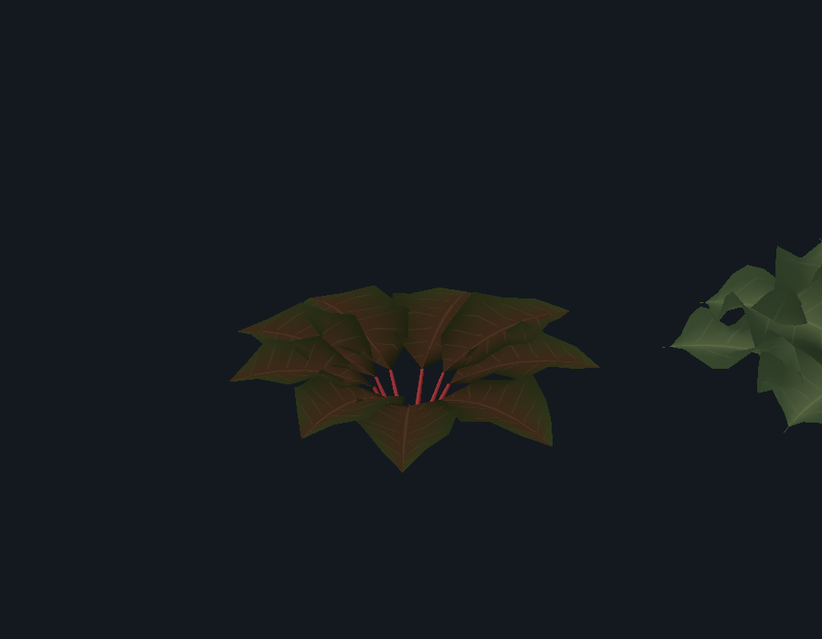
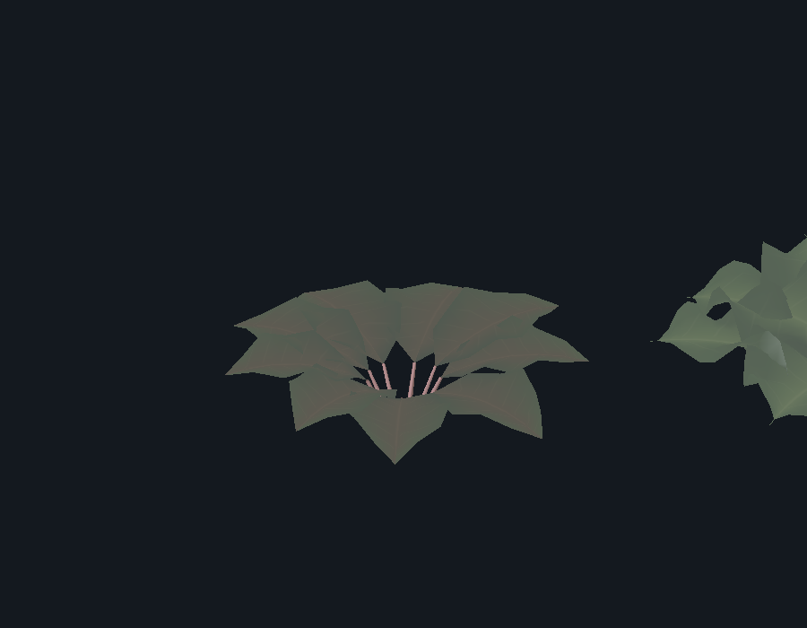
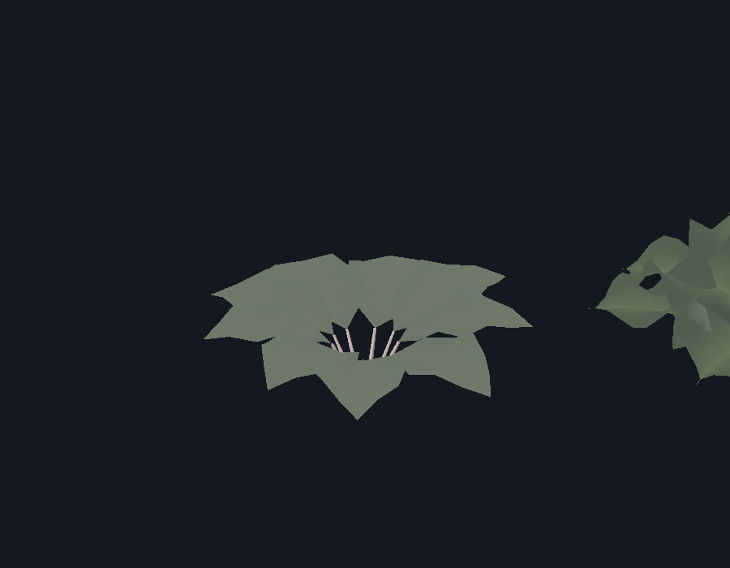

# Small story and greenhouse corrections

Start `8886280`; recovery tag `checkpoint/pre-atomic-story-crops-2026-10-25`. Each numbered change has its own local commit. No push. Claude's unfinished animal pass is outside this work.

1. Delivery chronology: the driver-sick override is restricted to worried Rowan on day two after 14:00. The existing day-three worried and ill dialogue can now play. The added day-three illness assertion failed before the fix; the complete town/save suite then passed **54 checks, zero failures** (`brave-and-cold/shots/atomic-story-chronology.log`). No new dialogue or stock behavior.

2. Conversation continuity: ordinary schedules wait while the resident is talking, including beyond the existing 18-minute grace. After closing the exchange the schedule catches up under its previous observation rules. The schedule suite passed **27 checks, zero failures**, including active conversation before/after the grace, release, and illness interruption (`brave-and-cold/shots/atomic-conversation-schedule.log`). Other observed transitions keep their existing policy.

3. Progressive frost: when stage/status stay unchanged, the existing leaf material receives the current simulated frost exposure. The blank-scene crop test passed **9 checks, zero failures**, including partial frost, stable mesh identity, private materials, warming in darkness, and the unchanged death threshold/appearance. An actual Forward+ D3D12 render on the GTX 1080 Ti passed the same assertions plus five capture checks (**14 total, zero failures**). The images below use a controlled diagnostic light; they demonstrate the existing shader response, not changed greenhouse lighting or a new plant asset.

[Recovered](atomic-story-crops-2026-10-25/recovered.png) and [dead](atomic-story-crops-2026-10-25/dead.png) captures are retained too. Render logs: `brave-and-cold/shots/atomic-crop-render.log` and `.err`; headless log: `atomic-crop-frost.log` in the same directory. The renderer reports sandbox user-log/shader-cache access errors; there are no shader compilation or GDScript errors.

Validation notes: the local headless run also reports the sandbox certificate-store error, the existing Terrain3D deprecation warning and a JSON-read error in the unrelated sound-board review loader. There were no GDScript errors. Assertions passed despite those diagnostics; they are not described as a clean application log. User saves and sound-review data were not edited.
