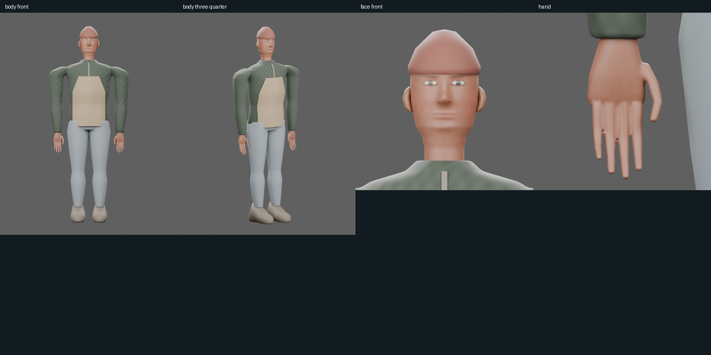
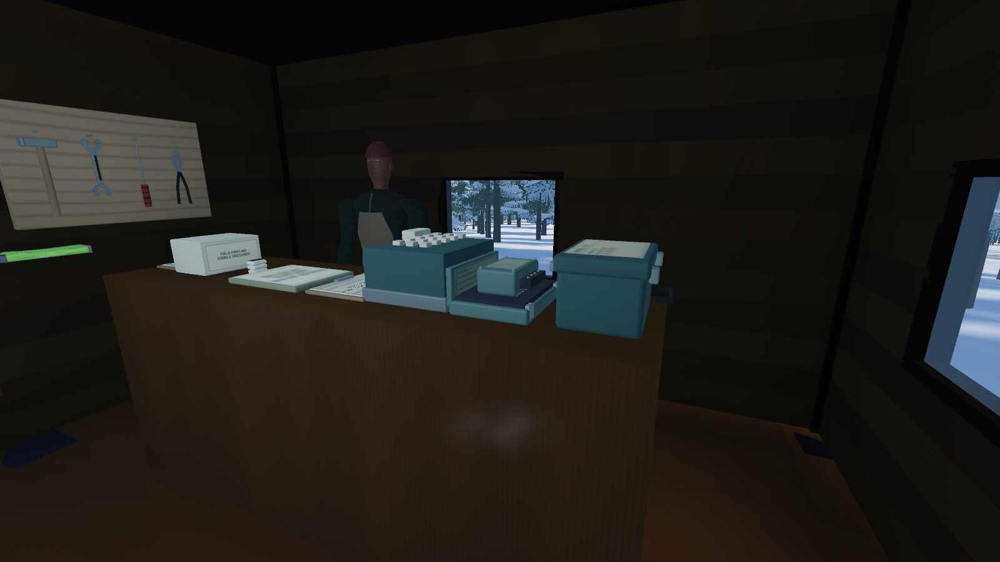
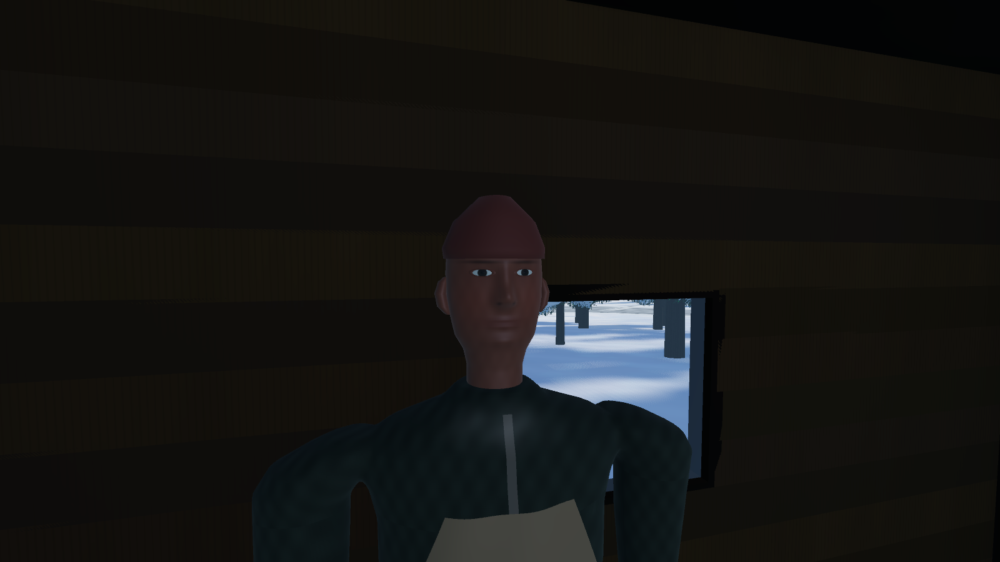
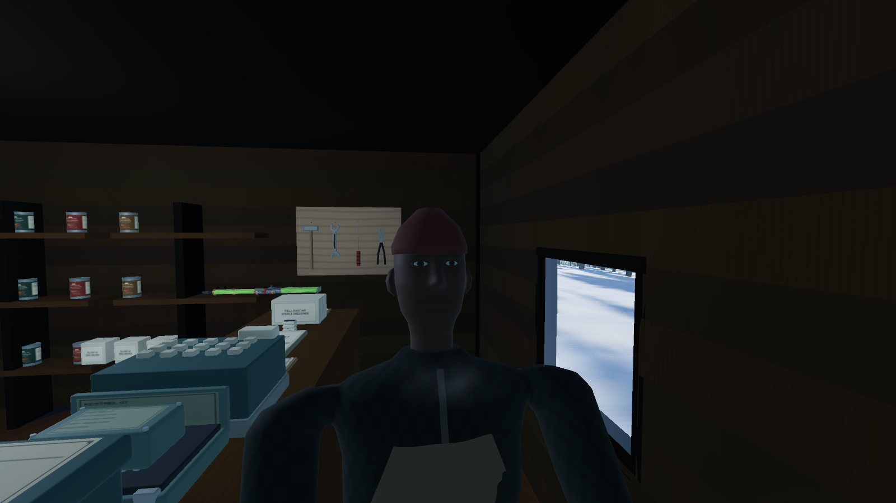

# Modular human foundation and town integration

The new human was authored from an empty Blender scene, preserving the previous worker/civilian assets. It has an anatomical torso, limbs and feet under removable garments, a shaped head/neck with ears, nose and lips, eye openings with seated eyes/lids, and integrated hands with five independent digits. The shared rig has 45 bones including wrists and three joints per digit; the eight existing logical limb drivers and hip/knee/ankle dimensions are retained.

Named modules: anatomy, head, eyes, hands, jacket, trousers, boots, cap and apron. Clothed exports omit buried body geometry. Native anatomy volumes remain hidden and editable. Procedural skin, woven cloth albedo/normal and eye maps are original; civilian coat palettes differ in the actual exported images. The infected preview has a separate gray skin map on the same body. Rowan measures 39,588 triangles and nine material surfaces; the other near variants measure 38,542 and seven. Height is 1.79–1.81 m above the sole, at metre scale.

Rowan, Sam and Lin now use the shared body. Hands have relaxed articulated finger poses and a stronger infected pose. Private head/hand materials progress from normal through pallor to infected skin; one actor cannot tint another. A dead infected retains that appearance on reload. Conversations, finite job stock, walking routes, owner pursuit around the counter, departures, exposure timing and permanent deaths retain their gameplay meaning. Anonymous pooled infected remain on the accepted worker asset until their separate rollout gate.

## Iteration and verification

Rejected candidates included forward-floating eyes, boxy shoulders, a stiff apron, merged sleeve/torso geometry below the armpit, discontinuous thumb/index weighting, and crotch weights that stretched when legs collapsed. Corrections include seated eyes with modeled lids, fitted shoulder geometry and rest joints, a draped apron, sleeve clearance, smooth webbing weights and continuous pelvis weighting. Existing deformation thresholds were retained; a candidate failing them was not accepted.

The four exported variants each pass actual skin-bind, articulated-hand, attack, six collapse variants, grade/threshold support, reset and pooling checks. The new boots also pass stance/sole alignment across 30/60/120 Hz, walking/chase speed and positive/negative grades. Tests retain the original worker's separate geometry cache. Actual-byte validation checks source/export hashes, 45 joint names, dimensions, finite indexed triangles, nondegenerate faces, unit normals, normalized weights, embedded images, PBR cloth and distinct palettes. Counts and source hashes are in the [receipt](modular-human-2026-10-14/receipt.json).

## Local frame cost

Six interleaved eight-second shop samples, two seconds of warmup each, actual 1920×1080 Forward+ / D3D12 on GTX 1080 Ti. Three resident nodes remain present; enabled samples verify one resident centre is visible. Enabled median frame time is 11.590 ms; enabled P95 ranges 12.293–14.678 ms. Disabled median is 11.860 ms. The small negative difference is within uncontrolled host/world variation and is not a speedup claim. This measures the current quiet shop with residents enabled/disabled, not old/new character CPU cost, a crowded street, or minimum-spec acceptance. [Raw timing](modular-human-2026-10-14/timing.json).

## Next improvements and recovery

The next visual gate is close conversation acting: further facial sculpt/retopology, brows, blinks, eye aim and mouth shapes, followed by directed voice performances. Fit seams, collars, apron straps/pockets and individual face/hair/body variants to this foundation. Add visible civilian work/shelter destinations and threat reactions before expanding the cast. Anonymous infected need damaged wardrobe, reduced distant geometry, crowd/pooling measurement and a separate acceptance pass. These remain planned work, not features delivered by this asset batch. The [implementation plan](../design/MODULAR_HUMAN_PLAN.md) defines the gates.

The editable master is `tools/blender/generated/modular_human/human_foundation.blend`; `brave-and-cold/assets/modular_human/README.md` explains the hidden anatomy and modules. Runtime poses remain state-driven; the GLBs contain no damage callbacks or facial animation clips. Screenshots and automated checks do not replace the user's first-shift and day-three return playtest.

Start checkpoint: `checkpoint/pre-human-foundation-2026-10-13` / `7822ca4`. Store placement is a separate local commit, `d4f2497`. Revert the following human-model commit to restore the earlier named bodies while keeping the placement fix. Revert the store commit afterward only if also removing its supported stock changes. No push, no user-save writes and no alteration of Claude's untracked reference files.
