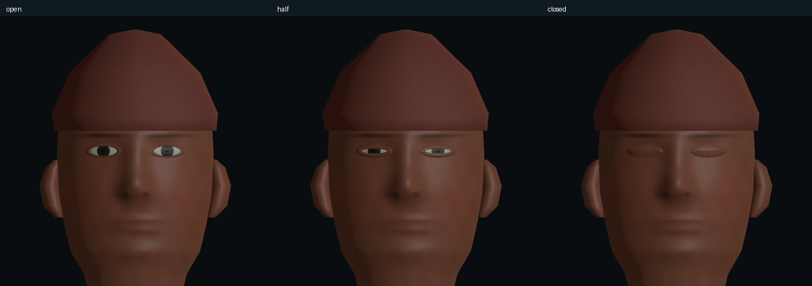
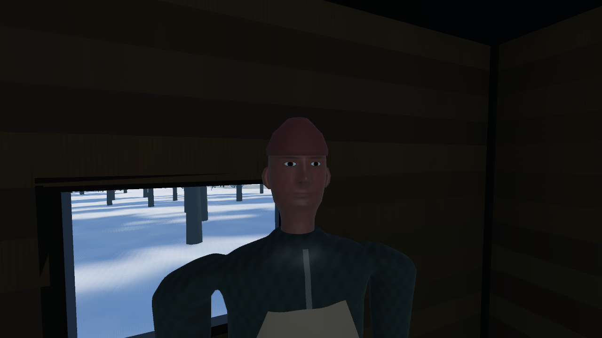
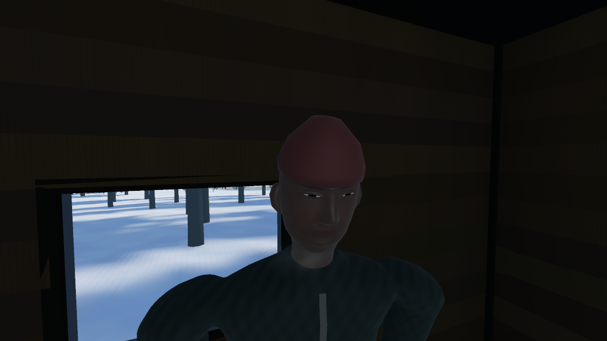

# Resident attention, blinks and readable decline

This pass makes the existing cast acknowledge the player and the equipment they discuss. The previous human master and runtime variants remain preserved. New models derive from that master into `assets/resident_presence/`, with an editable native copy at `tools/blender/generated/resident_presence/resident_presence.blend`.

## Implemented

Modeled eyelid closure is a named Blink morph on the existing head. Rest mesh dimensions, 45 bones, joint drivers, 39,588/38,542 triangle budgets and nine/seven surfaces are retained. The normal check found correct eye/lid winding and reversed zero faces. A controlled material comparison exposed excessive broad eye reflections; the new eye material reduces that glare while retaining a highlight. It is a material change, not a claim that the normals were wrong.

Living residents blink at independent intervals and ease their head/eye attention toward nearby visible players. Actual authored UV direction was checked, including the inverted glTF V coordinate. Bounded eye motion leads the head and releases when attention ends. The reserved-equipment topic prompts Rowan to briefly glance toward the actual relay case, with a small acknowledgement nod. The dialogue still displays immediately and remains optional; no mouth motion, synthesized voice or lip sync was added.

Damage, loud noise, closing the exchange and changing phase release conversational cues. Illness slows attention and blink timing. Unresponsive eyes rest partly closed; infected actors lose voluntary blinks/conversational attention while retaining their hostile head acting. Corpses settle into a static lid pose. Private eye materials and instance morph values prevent one person's state from affecting another. The cosmetic RNG does not consume gameplay randomness, and no cosmetic fields are added to saves.

The store capture also exposed backward whole-model illness tilt. Weakness now flexes the spine forward while the root and feet remain planted. Collapse blends from that weakened pose without snapping upright first. Actual morph-plus-skin probes verify the closed-lid corpse's support and bounded slump deformation.

## Evidence and limits

The independent GLB reader now handles sparse morph accessors. The engine probe handles normalized blend-shape buffers as absolute target positions, rather than mistaking them for displacement vectors. Static validation and actual render checks are separate. [Receipt and test results](resident-presence-2026-10-14/receipt.json) contain measured counts and hashes.

The portrait comparison uses a controlled diagnostic light, not a changed town light. The following are captures in the existing store:

Automated checks cover individual actor isolation, attention direction, the opaque store wall, unseen players behind actors, phase behavior, actual head rotation, RNG separation, interruption, foot support, collapse start and morph/skin corpse support. Four variants retain the full body/hand/attack/collapse checks; gait/contact and real town death/reload/legacy-save checks remain required. Capture and timing receipts are local diagnostics, not human play acceptance or a crowded-population performance guarantee.

The completed checks total 558 engine/state/deformation assertions and 142 asset assertions, with zero failures. Six alternating 1080p quiet-shop samples on the GTX 1080 Ti gave median sample times of 12.568 ms with residents enabled and 12.688 ms disabled. Enabled sample P95 ranged from 15.138 to 16.622 ms. The small reversed median difference is host/run variance, not an optimization claim. Only one resident centre was visible, and this is an on/off comparison within the current scene, not a comparison against the previous commit. A crowded street and minimum-spec acceptance need their own measurements.

## Critical next work

The cast still needs purposeful work/rest schedules. Lin and Sam's repeated outdoor loops do not yet support the cold-weather story. Their next pass should use warm destinations and visible transitions, handle player-barricaded doors and preserve optional access to job gear. Distinct faces/hair, fitted clothes and real hand contact with work props will make the existing people recognizable. Further facial sculpt/retopology and a proper mouth precede directed speech. Expanding the cast before those patterns work would repeat their current weaknesses.

The opening play gate remains one complete lookout trip, relay repair, return and food/fire preparation, followed by the day-three shop encounter. Additional logging-road work should teach useful survival decisions and provide clear reasons to leave and return. Hunting, cooking and preservation should establish the winter food loop before farming infrastructure. The [next-pass plan](../design/RESIDENT_PRESENCE_PLAN.md) specifies these priorities and acceptance checks.

## Recovery

Checkpoint `checkpoint/pre-resident-presence-2026-10-14` points to `15f0b46`. Reverting this presentation commit returns the original human variants and acting while preserving `d4f2497`'s store placement fix. No push, no user save writes, and Claude's existing untracked files remain untouched.
