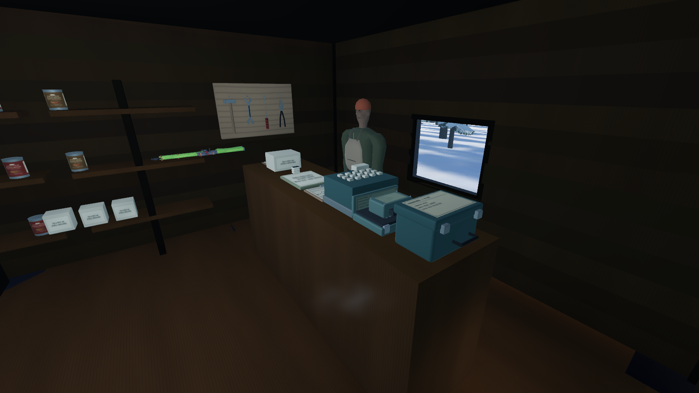
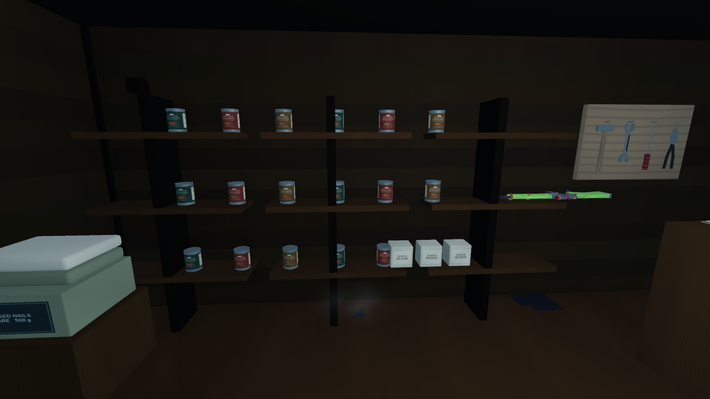
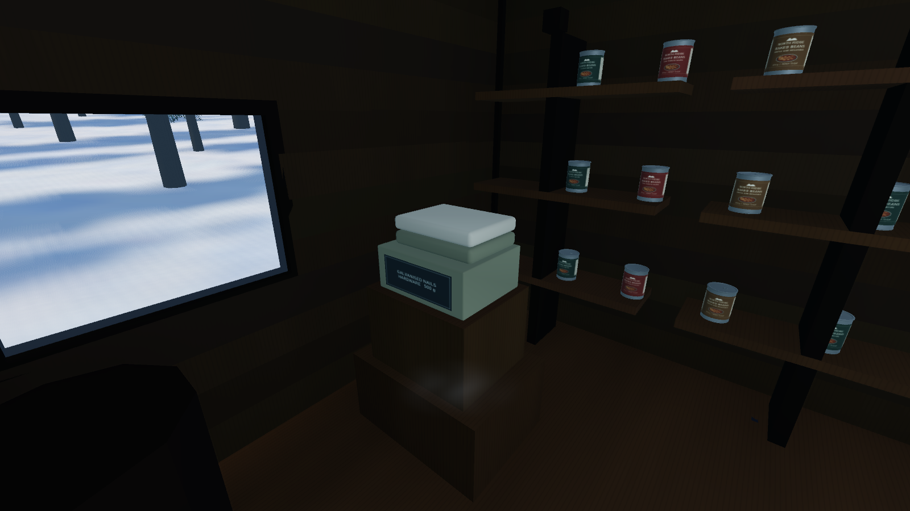

# General store placement

The winter controller and delivery slate were outside the counter footprint. The relay and ledger had smaller support gaps. All four now sit on the existing 1.40 m counter, with 1–2 mm clearance, separated from each other and the register. Case collection and reading anchors follow their moved models. The furniture, building and collision layout are preserved.

Stock corrections use world coordinates: the joined Blender groups retain their first object's origin. Tins and medical packs rest on the existing shelf tops; hardware sits on the upper crate and folded wool stacks above it. The first local-coordinate candidate was rejected by independent exported-byte support checks and re-generated correctly. Original source and runtime dressing remain available.

The service rifle formerly used the elevated shelf search marker with random orientation. It now fits the empty middle shelf, 1.06 m long by .267 m deep, resting 2 mm above its top. An authored-placement tag preserves orientation on reload. Only the exact old elevated cache position migrates; normal ground drops remain untouched. Quantities and pickup condition are preserved.

Validation: 35 engine placement/transaction/reload checks, 49 electrical fieldwork checks, 53 opening checks, and 29 independent source/GLB support checks; zero failures. Actual engine views:

Recovery starts at `checkpoint/pre-human-foundation-2026-10-13` / `7822ca4`. This fix is committed separately from the new character. Reverting its commit restores the original dressing and locations; older readers ignore the extra pickup support field without duplicating the item. No push. [Receipt](store-supported-2026-10-13/receipt.json).
