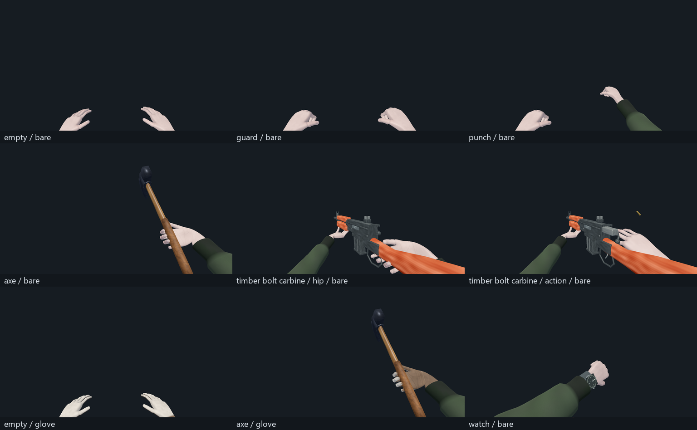
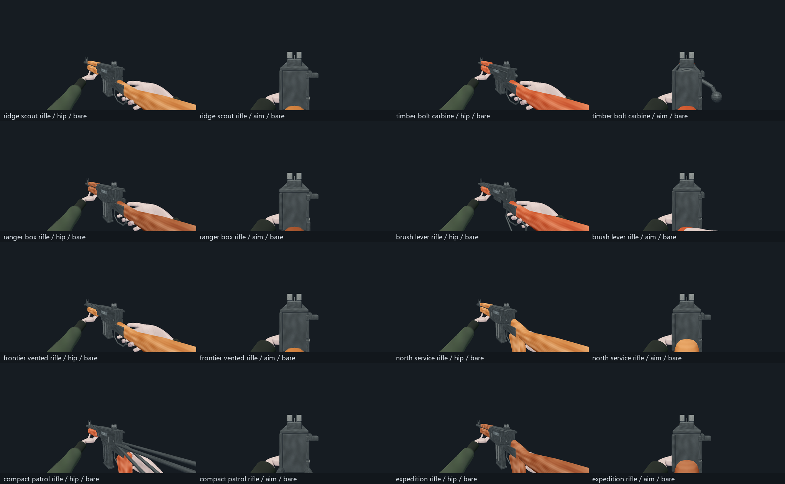

# Anatomical hands and weapon attachments

The approved anatomical hands now replace the live first-person hands. The existing hunting rifle uses the complete timber bolt carbine model, with its moving bolt, trigger, casing, muzzle marker and two-handed grips. The original bare-hand candidate and the standalone eight-weapon source kit remain unchanged.

## Play test

In the game, raise the rifle with **X**, aim with the right mouse button and fire as before. Check the stock grip and fore-end hand, recoil, casing and bolt cycle. Try the hatchet, splitting, hammering, drinking, treatment and the **T** watch gesture with and without mitts. Empty hands rest in a relaxed pose; right mouse raises a guard, and an unarmed attack closes the fist before the strike.

For all eight weapon models, open `brave-and-cold/tests/visual/weapon_hand_review.tscn` in Godot and run that scene. Keys **1–8** select variants, **0** selects empty hands, and **9** selects the hatchet. Left click/Space strikes or fires; right mouse guards or aims. **R** previews a tactical reload, **E** an empty reload, **I** inspect, **G** gloves, and holding **T** checks the watch. The lever rifle uses the individual-round insertion clip. This scene creates no inventory or save state.

Reloads are presentation clips in this integration. The live game's existing reserve-ammunition system still owns shot consumption; this change does not introduce magazine capacity, new ammunition families, new weapon inventory IDs or eight new loot entries. Those mechanics can use the fitted component sockets without replacing this rig.

## What changed

- Two 17-joint anatomical rigs, connected skin topology, separate rigid nail plates, original skin maps, and thin fitted leather gloves with an original seam atlas. Nails hide when gloves are worn.
- Fifteen hand poses and fourteen volume correctives, including separate stock, pistol-trigger, trigger-press, fore-end, tool, flask, pinch and magazine poses.
- The complete weapon component hierarchy stays intact. Animated magazine and action sockets carry the corresponding hand, with calibrated offsets in moving socket coordinates. Semi-automatic reloads use the charging tab; the carbine uses its bolt handle.
- Independent forearm articulation bends toward the sleeves while preserving the finger transforms. Wider cuffs cover the forearm throughout raised actions. The existing watch bracelet is seated on the narrower wrist while its circular dial and clock-driven needles remain intact.
- Existing work actions still own timing, impacts, costs and cancellation. Weapon manipulation cancels when work, UI, death or equipment switching takes over. The flask now tilts with its gripping hand during a sip.

The editable, packed Blender source is `tools/blender/generated/live_hand_rig_v2/anatomical_hand_rig.blend`. It opens on right bare anatomy; other variants are hidden for editing. `LIVE_RIG_README` explains the coordinate system, poses and correctives. The live GLB is `brave-and-cold/assets/models/viewmodel/anatomical_hand_rig.glb`; weapon models and calibrated contact profiles are under `brave-and-cold/assets/weapons/north_ridge/`.

## Validation and limits

The final GLB has two 17-joint skins, six meshes and sixteen animation clips, with finite bind matrices, normalized four-bone weights, valid indices and a matching morph channel for each bare/glove mesh in each clip. Original source byte rosters and the nine vendored GLB hashes were verified.

- **60 native pose checks:** zero non-neighbour triangle intersections across both bare hands and both gloves.
- **25 sampled prop contacts:** actual Godot-skinned glove vertices against the imported weapon/tool triangles. Closed components are classified with solid-angle winding; maximum sampled overlap is **2.953 mm**, within the **3.5 mm** fit tolerance, with surface contact present in every case. This is a presentation fit test, not a gameplay collision mesh or proof over every interpolated frame.
- **67 viewmodel assertions passed:** actual skin deformation, mirrored joints, forearm contact invariance, tool contacts, all imported weapon clips, wrist/cuff continuity, magazine tracking, work cancellation, equipment switching, gloves, death and revival.
- **Tower survival-prop regressions passed**, including service-hammer grip, work completion/cancellation and restored stock visuals. **32 field-survival checks passed**, including equipment condition, repairs and save restoration.
- **82 final Vulkan/Forward+ GPU captures** on the GTX 1080 Ti, plus actual outdoor watch/treatment/flask captures. World fixture shutdown retains its existing CanvasItem/ObjectDB warnings; scenario assertions pass.

Exact final bytes, fit measurements and capture provenance are recorded in `validation.json`, `pose_audit.json`, `contact_fit_audit.json` and `package_hashes.json` under the live rig source folder. Authoring fit scripts emit candidates; candidates must pass the pose and runtime contact audits before being applied. No generated candidate is automatically installed.

## Reversibility

The prior local checkpoint is `e816d89`. This integration is a separate local commit and is not pushed. Reverting the integration commit restores the previous live hands and rifle presentation. Avoid resetting the whole checkout when other work is present.

The map, survival resource rules and save format are unchanged by this integration.
